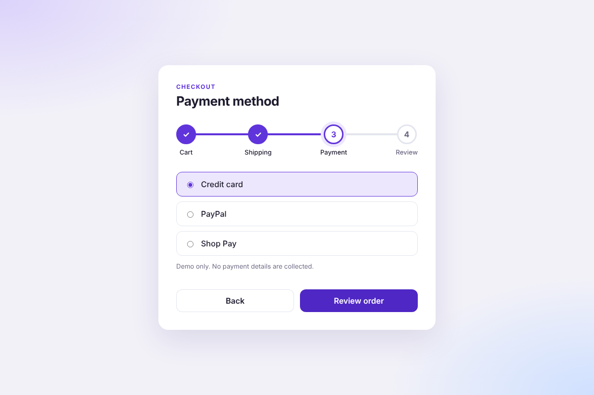

# Progress Steps

A reusable progress stepper that guides users through a multi-step process, shown here as a four-step checkout: Cart, Shipping, Payment and Review.

**Live demo:** https://jhwang2525.github.io/progress-steps/

## Features

- Animated progress bar and step states (upcoming, active, complete)
- Content panel for each step with a dynamic title and button label
- Back / Continue buttons with correct disabled states
- Arrow-key navigation and `aria-current` for screen readers
- Responsive down to small phones

## Built with

HTML, CSS and vanilla JavaScript.
